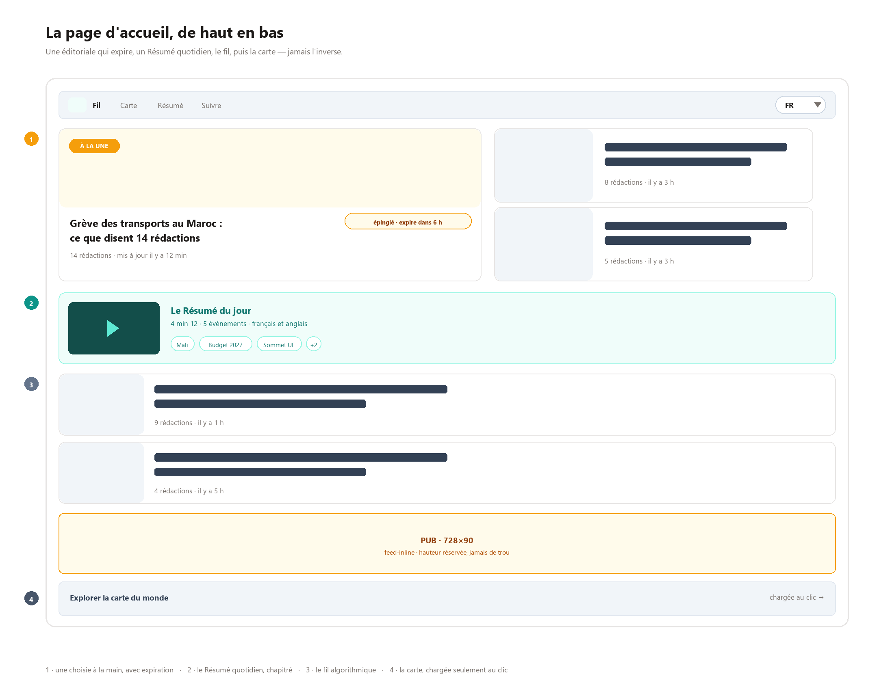
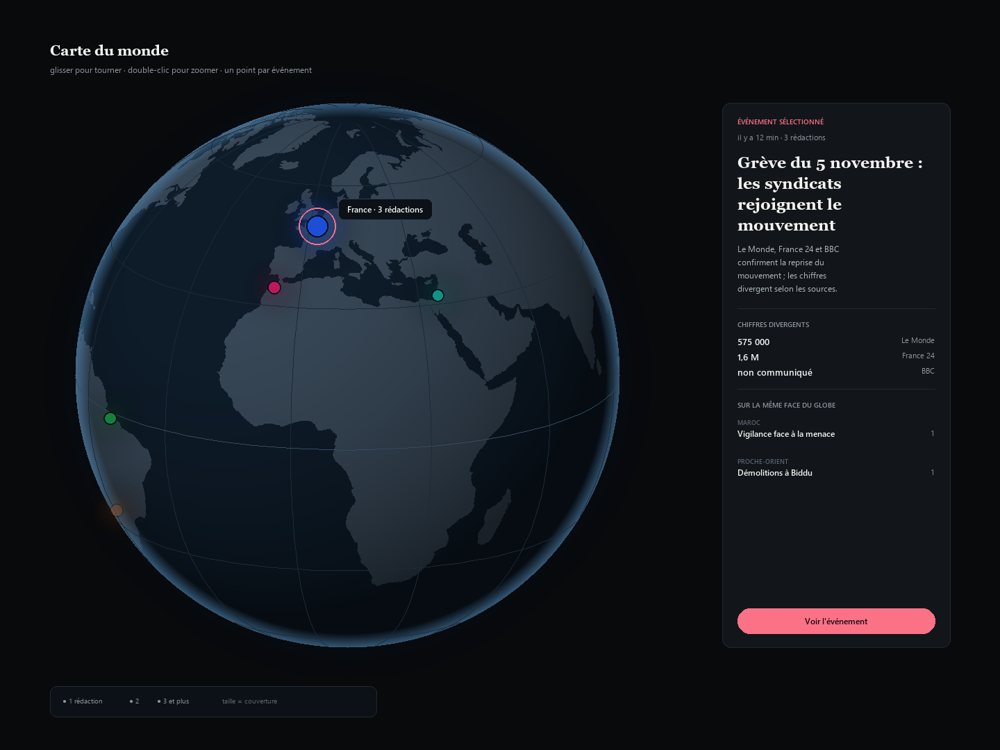
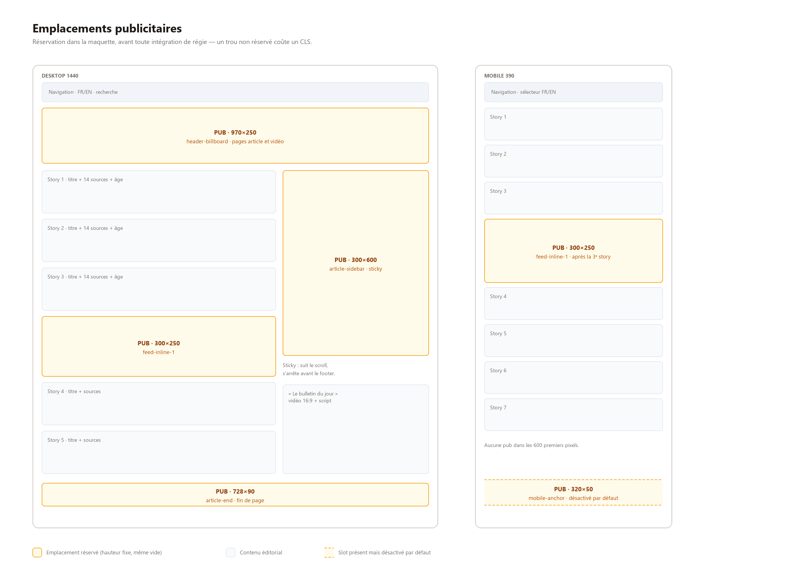
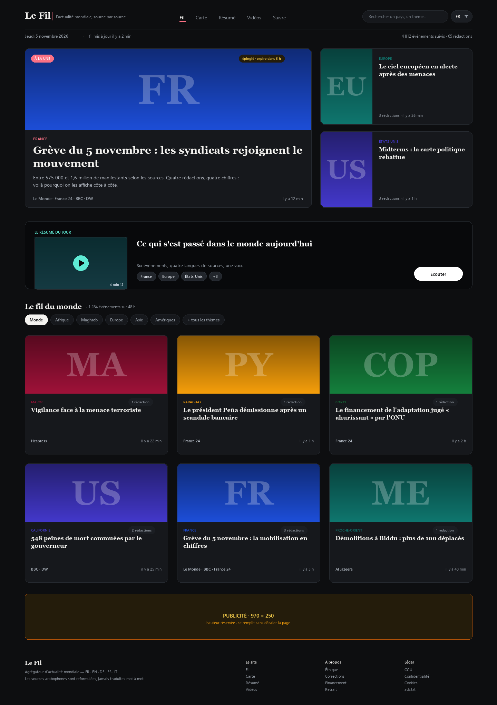
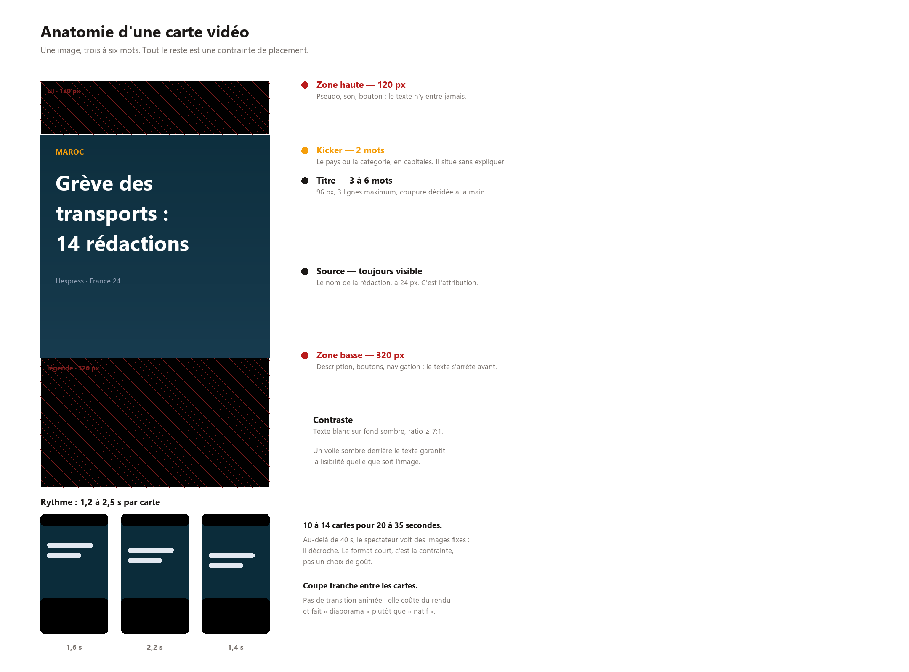
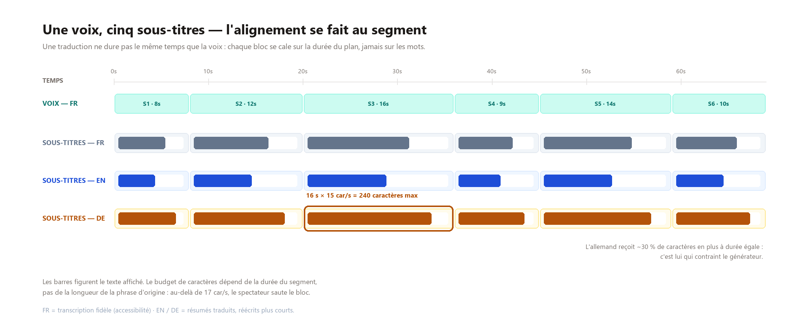

# Plan d'architecture — Plateforme d'actualité mondiale + usine vidéo

**Version** : 1.0 · **Date** : 5 novembre 2026 · **Périmètre** : MVP → production
**UI en cinq langues : FR · EN · DE · ES · IT** · **sources arabes reformulées, jamais un RTL de page** · **Sources RSS aujourd'hui, connecteurs API demain**

---

## 1. Résumé exécutif

Le produit a deux moitiés qui n'ont ni le même rythme, ni les mêmes risques :

| Moitié | Ce que ça fait | Risque dominant |
|---|---|---|
| **Le site** | Agrège les dépêches du monde entier, les regroupe par événement, et laisse l'utilisateur suivre des pays, des régions et des sujets | Technique (qualité du regroupement, fraîcheur) |
| **L'usine vidéo** | Chaque jour, transforme 3 à 5 événements majeurs en vidéos verticales sous-titrées, publiées sur YouTube / TikTok / Instagram / X | **Juridique et plateforme** (droits, quotas, audits d'API) |

Trois décisions structurent tout le reste :

1. **On ne republie jamais un article.** On affiche un titre, un extrait très court (≤ 150 caractères), la source et un lien. C'est ce qui rend le projet légalement tenable sans contrat de licence — et c'est aussi ce que permettent les flux RSS. Conséquence assumée : le site est un **aiguilleur vers la source**, pas une destination finale. C'est un produit différent de Google News, mais c'est le seul qui soit finançable en solo.
2. **Le regroupement d'articles en « événements » est le cœur du produit**, pas un détail. Sans lui, on obtient un mur de 5 000 liens par jour. C'est là que doit partir l'essentiel de l'effort d'ingénierie.
3. **La vidéo est un produit séparé qui consomme la base**, pas un module du site. Elle a son propre pipeline, son propre rythme (quotidien), ses propres échecs (rendu, upload, refus de plateforme). On ne la code qu'une fois que le site tourne.

**Ce que j'ai vérifié avant d'écrire ce plan** (le 5 novembre 2026, depuis cette machine) : sur 81 entrées testées (68 flux de rédaction, 7 flux Google News, 6 API), **65 flux répondent et contiennent des articles**. AFP répond 403, Reuters a purement disparu, Xinhua bloque le certificat TLS. Le détail mesuré est en § 4.3 — c'est la base réelle du socle de sources, pas une liste théorique.

---

## 2. Périmètre

### 2.1 Dans le MVP

- **Explorer** : filtre par pays (195), par région ONU (5 continents / 22 sous-régions), par thème, par source, par langue, par fenêtre temporelle ; carte du monde sur une page dédiée.
- **La une** : un événement principal et deux secondaires, **choisis à la main** et expirant automatiquement.
- **Le Résumé** : un bulletin quotidien de 3 à 5 minutes, en français et en anglais, chapitré et relié aux pages événement.
- **Événements** : un événement = un regroupement d'articles de plusieurs rédactions sur le même fait. On affiche « 14 rédactions en parlent », avec les angles de chacune.
- **Suivre** : un compte, une liste de pays/régions/thèmes suivis, un fil personnalisé, une newsletter quotidienne dans la langue de l'utilisateur.
- **Cinq langues** : interface FR, EN, DE, ES, IT. Les sources arabophones sont couvertes, et leur contenu reformulé vers la langue du lecteur — le titre original restant toujours visible et cliquable.
- **Fraîcheur** : un article publié doit être visible en moins de 10 minutes (p95).

### 2.2 Dans la phase vidéo (après le site)

- 3 à 5 vidéos/jour, format 9:16, **20 à 35 s**, faites de 10 à 14 cartes « une image + trois à six mots », voix synthétique, sources citées à l'écran.
- Publication automatique sur YouTube Shorts, TikTok, Instagram Reels, X.
- Journal de bord éditorial : sélection, validation, publication, statistiques.

### 2.3 Explicitement hors périmètre (v1)

- Republication d'articles complets, paywall, ou archive PDF.
- Commentaires, forum, UGC.
- Application mobile native (le web responsive suffit ; PWA en option).
- Traduction automatique intégrale des articles (coût et responsabilité éditoriale trop élevés au départ).
- Publicité / monétisation (à trancher, cf. § 14).

---

## 3. Décisions d'architecture

Format court : décision → pourquoi → ce qu'on écarte.

### ADR-01 — Deux runtimes : Python pour la donnée, TypeScript pour l'interface

Python parce que tout l'écosystème NLP/ML (embeddings, détection de langue, clustering) y est natif et que l'ingestion est un travail de données. TypeScript/Next.js parce que la carte interactive, le rendu serveur et l'i18n y sont meilleurs qu'en Python.

*Écarté* : tout-Python (Django) — la carte et l'i18n coûtent plus cher ; tout-Node — le NLP coûte plus cher.

### ADR-02 — PostgreSQL + pgvector comme unique base

Une seule base pour le relationnel, le texte intégral (FTS) et les vecteurs d'embedding. À l'échelle du MVP (5 000 articles/jour, ~50 000 événements/an) c'est largement suffisant et ça supprime un service à exploiter.

*Écarté* : Elasticsearch/OpenSearch (un service de plus, coût mémoire), Qdrant/Milvus (utile seulement au-delà de ~10 M de vecteurs), MongoDB (perte des jointures qui font tout le produit).

### ADR-03 — Le poller respecte les serveurs des autres

Requêtes conditionnelles `ETag` / `If-Modified-Since`, intervalle par source (300 s pour une dépêche, 1 800 s pour un hebdo), backoff exponentiel, `User-Agent` identifiable avec URL de contact, un seul worker par domaine. Objectif : être un bon citoyen du web et ne jamais se faire bloquer.

*Écarté* : polling agressif « toutes les 60 s sur tout » — c'est le meilleur moyen de se faire bannir en une semaine.

### ADR-04 — Clustering incrémental, pas de re-clustering global

Chaque article est comparé aux événements des 72 dernières heures seulement, via un index HNSW. Un événement est créé ou rejoint en O(log n). On ne relance jamais un clustering sur toute la base.

*Écarté* : batch nightly sur tout le corpus — coût quadratique, et les événements changent d'identifiant (donc les liens partagés cassent).

### ADR-05 — Vidéo : rendu déterministe par template, pas de génération d'images

Chaque plan est une **carte générée par du code** : un fond déterministe, la typographie, trois à six mots, le nom de la source. Aucune image produite par IA, aucune photo tierce. Raisons : coût, cohérence de marque, et surtout **responsabilité** — une image inventée sur une actualité est un risque qu'on ne veut pas porter.

*Bénéfice imprévu* : un diaporama d'images ne demande plus de navigateur headless. Le rendu se fait avec `Pillow` pour les cartes et `ffmpeg` pour l'assemblage — quelques secondes de CPU, aucune dépendance à Remotion ni à Chromium.

*Écarté* : génération d'images/vidéo par IA (illisible juridiquement sur du contenu d'actualité), montage manuel (ne passe pas l'échelle).

### ADR-06 — Publication vidéo derrière une porte humaine jusqu'à preuve de fiabilité

Les 20 premières vidéos sont validées à la main avant publication. Automatisation complète seulement si le taux d'erreur factuelle reste sous 2 % sur 20 vidéos consécutives. Un faux chiffre publié sur TikTok coûte plus cher que 100 vidéos non publiées.

### ADR-07 — Hébergement en UE, données minimisées

VPS en Allemagne/Finlande, pas de PII au-delà de l'e-mail, pas de tracker tiers (analytics sans cookie). Simplifie le RGPD et rassure une audience européenne.

---

## 4. Le volet juridique (à lire avant d'écrire une ligne de code)

C'est la partie qui décide si le projet existe. Trois sujets distincts.

### 4.1 Ce qu'on a le droit de faire avec un flux RSS

Un flux RSS est **publiquement accessible**, ce qui n'autorise pas à republier son contenu. La pratique sûre, et celle qui tient devant un juge :

| Élément | Ce qu'on affiche | Pourquoi |
|---|---|---|
| Titre | Tel quel | Le titre est un élément factuel court ; c'est l'usage constant de la presse |
| Extrait | ≤ 150 caractères, ou le `description` du flux tronqué | Reste dans le « droit de citation » (CPI art. L122-5) et sous le seuil des « extraits très courts » de l'art. 15 de la directive CDSM (droit voisin de la presse) |
| Image | **On ne l'héberge pas.** Soit on n'affiche rien, soit on utilise une vignette générée (dégradé + nom de la source), soit on pointe l'URL d'origine avec attribution | Le droit d'auteur sur la photo n'est jamais cédé par le RSS |
| Texte complet | **Jamais.** Lien sortant uniquement (`rel="noopener"`, `target="_blank"`) | C'est le seul montage qui ne demande aucune licence |
| Logo de la source | Dans une limite raisonnable, avec le nom en texte | Usage informatif ; à retirer sur demande |

Deux obligations concrètes à implémenter dès la v1 :

- **`robots.txt` + `Crawl-delay` respectés**, et un endpoint `/.well-known/` documentant le robot.
- **Retrait sur demande** : une page de contact et une procédure de retrait en < 48 h, avec un flag `blocked` en base par source et par article.

### 4.2 Le cas AFP / Reuters / RT — les trois pièges

**AFP** : pas de flux public (vérifié : HTTP 403). L'AFP se licencie — contrat de redistribution, ou accès via l'API AFP Forum. Budget à prévoir si l'AFP est indispensable à la crédibilité du produit. **Recommandation : ne pas bloquer le MVP dessus.** On couvre l'actualité mondiale avec les autres, et on ajoute AFP en phase 2 si le produit trouve son public.

**Reuters** : le domaine `feeds.reuters.com` ne résout plus (vérifié : la résolution DNS échoue). Ce n'est pas une panne, c'est une fermeture. Même conclusion.

**RT (Russia Today)** : le flux fonctionne techniquement (100 items, 2,9 s de latence), mais sa **diffusion est suspendue dans l'UE** depuis mars 2022 (règlement (UE) 2022/350 et ses modifications). Cela couvre la distribution par « toute plateforme » — site web et réseaux sociaux inclus. Un site édité depuis l'UE qui republie RT et pousse ses contenus sur TikTok s'expose directement.

**Recommandation : exclure RT du corpus distribuable.** Si le besoin est de couvrir la Russie, on le fait avec TASS, Kommersant, Meduza, The Moscow Times, ou des correspondants occidentaux à Moscou. Le champ `licence` en base (§ 8) doit porter cette information pour que le code puisse refuser d'afficher ou de publier un contenu non distribuable, plutôt que de compter sur la vigilance humaine.

### 4.3 Le catalogue testé : 39 flux sur 48

Le catalogue est versionné dans [`sources/catalog.json`](sources/catalog.json) et audité par
[`tools/check_feeds.py`](tools/check_feeds.py). Il contient 81 entrées : 68 flux de rédaction,
7 flux Google News, 6 API. Tout a été testé le 5 novembre 2026 au soir.

| Zone | Flux testés | Exploitables | Ce qui casse |
|---|---|---|---|
| Europe | 6 | 5 | Reuters : `feeds.reuters.com` ne résout plus, le domaine est mort |
| Allemagne | 9 | 9 | Le panel le plus solide : Tagesschau, Spiegel, FAZ, Süddeutsche, Zeit, Handelsblatt, n-tv, DLF, DW |
| Italie | 6 | 6 | Rien à signaler — ANSA, Corriere, Repubblica, Sole 24 Ore, Il Post, Sky TG24 |
| Espagne | 5 | 5 | El Mundo, ABC, elDiario, La Vanguardia, Europa Press — tous OK |
| Amérique du Nord | 9 | 6 | CTV 404 · AP 403 · Washington Post 502 (peut être transitoire, à revérifier) |
| Amérique du Sud | 5 | 3 | El Tiempo renvoie un XML malformé · Emol coupe la connexion |
| Afrique | 5 | 4 | Africa.com : certificat TLS invalide |
| Maghreb | 8 | 7 | El Watan coupe la connexion ; les 4 sources marocaines passent |
| Asie | 5 | 5 | Rien à signaler : la zone la plus solide du panel |
| Moyen-Orient | 3 | 2 | Arab News 403 (filtrage anti-bot) |
| Monde arabe | 7 | 6 | Al Arabiya 403 sur toutes ses variantes, y compris `.mrss` |
| Google News | 7 | 7 | Techniquement parfait — mais voir § 4.4 |

Bilan : **58 rédactions exploitables sur 68** (hors Google News), 3 340 articles vus au premier
chargement. Le tableau complet, source par source, est dans
[`docs/sources-catalogue.md`](docs/sources-catalogue.md).

Quatre choses que ce test contredit :

- **CNN fonctionne.** `rss.cnn.com` est de nouveau servi (69 items) : beaucoup de listes le
  donnent pour mort depuis 2023, ce n'est plus vrai. Toujours tester avant de recopier une liste.
- **Reuters et AP ne reviendront pas par RSS.** Reuters a fait disparaître le domaine, AP répond
  403. Ce n'est pas un incident technique, c'est une décision économique : la dépêche se vend,
  elle ne s'offre pas.
- **Le Maghreb est étonnamment sain.** Hespress (FR et AR), Aujourd'hui le Maroc, La Vie Éco,
  TSA, Business News et Mosaïque FM répondent tous. C'est la zone où un site francophone se
  différencie le plus vite, parce que peu de gens l'agrègent correctement.
- **Le monde arabe est bien couvert — à une exception.** Asharq Al-Awsat renvoie 300 items à lui
  seul ; Al Jazeera AR, France 24 AR, BBC Arabic, DW AR et Sky News Arabia répondent. Seul
  Al Arabiya bloque, sur toutes ses variantes d'URL. La couverture arabophone ne dépend donc
  pas d'une seule source, ce qui est exactement ce qu'on veut.

Les latences du tableau sont mesurées à 10 requêtes en parallèle : elles sont gonflées par la
concurrence et ne doivent pas servir au dimensionnement. Un poller réel étale ses requêtes.

**Le socle pour démarrer : 41 flux, 6 langues, 10 zones** — tous vérifiés opérationnels.
La première vague suffit pour un site FR/EN ; la seconde ouvre l'arabe, l'espagnol et l'italien.

- **Europe (5)** : BBC World, France 24, Euronews, Politico Europe, Deutsche Welle.
- **Amérique du Nord (4)** : New York Times, CNN, CBC, Radio-Canada.
- **Amérique du Sud (3)** : Folha de S.Paulo, La Nación, Clarín.
- **Afrique (3)** : Africanews, Jeune Afrique, AllAfrica.
- **Maghreb (4)** : Hespress FR, Hespress AR, La Vie Éco, TSA Algérie.
- **Asie (3)** : SCMP, The Japan Times, Nikkei Asia.
- **Moyen-Orient (2)** : Al Jazeera, Middle East Eye.

Puis, au moment d'ouvrir l'allemand, l'espagnol et l'italien :

- **Espagne (5)** : El Mundo, ABC, elDiario.es, La Vanguardia, Europa Press.
- **Allemagne (9)** : Tagesschau, Der Spiegel, FAZ, Süddeutsche Zeitung, Die Zeit, Handelsblatt,
  n-tv, Deutschlandfunk, DW Deutsch.
- **Italie (6)** : ANSA, Corriere della Sera, La Repubblica, Il Sole 24 Ore, Il Post, Sky TG24.

Et dès le premier jour, les sources arabophones — elles ne dépendent d'aucune locale, elles
alimentent les quatre :

- **Arabe (6)** : Hespress AR, Al Jazeera AR, Asharq Al-Awsat, France 24 AR, BBC Arabic, Sky News Arabia.

### 4.4 Google News : un capteur, pas une source

Les 7 flux Google News répondent tous (90 à 100 items chacun, 600 articles à eux seuls). C'est
tentant, et c'est un piège sur trois plans :

1. **Les liens sont des redirections** `news.google.com`, pas l'URL de l'éditeur. Il faut les
   résoudre pour retrouver la source réelle — fragile, et Google casse ce mécanisme régulièrement.
2. **Les conditions d'utilisation de Google News interdisent la réutilisation automatisée** du
   service et des contenus. Un site public qui s'en nourrit est en infraction, même s'il ne
   republie que des titres.
3. **La qualité est inégale** : un flux `q=Maroc` ramène des dépêches du monde entier qui
   mentionnent le mot, pas l'actualité marocaine.

**Usage recommandé : capteur interne.** Google News sert à détecter un sujet qui monte ou une zone
mal couverte par le panel RSS — jamais à alimenter une page publique. C'est exactement le rôle de
**GDELT**, gratuit, multilingue (100+ langues), géolocalisé et explicitement conçu pour l'analyse :
à préférer.

### 4.5 Les API de presse : ce qu'elles valent vraiment

| API | Offre gratuite | Force | Verdict |
|---|---|---|---|
| GNews | 100 req/jour, 10 articles par requête | 65 langues, recherche par pays | Bon plan B pour combler un trou de couverture |
| NewsAPI.org | 100 req/jour | 150 000 sources | **Piège** : l'offre gratuite est réservée au développement, l'usage en production est interdit sans plan payant. Beaucoup de tutoriels l'ignorent |
| NewsData.io | 200 crédits/jour | Afrique, Moyen-Orient | Le plus pertinent pour les zones où le RSS est faible |
| Mediastack | 500 requêtes/mois | — | Trop bas pour un site public |
| Currents API | 600 req/jour | — | Correct, couverture moyenne |
| SerpApi (Google News) | payant | Résout proprement Google News | Contourne les CGU de Google : à éviter |

**Règle** : le RSS reste la colonne vertébrale (gratuit, légal, frais). Une API n'entre dans le
pipeline que pour combler un trou identifié — l'Afrique et le Moyen-Orient anglophones,
typiquement — et sous contrat. Techniquement, aucun code spécial : un connecteur API produit les
mêmes `raw_items` qu'un flux, avec `sources.licence = 'licensed'`.

### 4.6 Vidéo et réseaux sociaux

- **Voix synthétique** : YouTube impose de déclarer les contenus « réalistes » générés ou synthétisés. Une voix off clairement synthétique + un habillage graphique identifiable est la voie la plus propre. Interdiction absolue de cloner la voix d'un journaliste.
- **Musique** : uniquement les bibliothèques audio des plateformes (elles couvrent la revendication de droits) ou du CC0. Jamais de musique « trouvée sur internet ».
- **Images** : typographie + cartes + aplats de couleur. Pas de photo tierce, pas de capture
  d'écran d'article — et pour les vidéos de sources, **intégration du lecteur officiel
  uniquement, jamais de ré-hébergement** (§ 11.7).
- **Citation des sources** : le nom de chaque rédaction apparaît à l'écran quand son information est utilisée. C'est à la fois une obligation morale et un signal d'algorithme.
- **RGPD** : base légale = exécution du contrat (compte) et intérêt légitime (newsletter). Analytics sans cookie. Droit à l'effacement automatisé.

---

## 5. Vue d'ensemble

```
        ┌──────────────┐
        │  30+ flux    │  RSS 2.0 / Atom / RDF
        │  + API (v2)  │  ETag, backoff, rate-limit par domaine
        └──────┬───────┘
               ▼
      ┌─────────────────┐     ┌──────────────────────┐
      │  1. INGESTION   │────▶│  raw_items (brut)    │  jamais modifié, rejouable
      └────────┬────────┘     └──────────────────────┘
               ▼
      ┌─────────────────┐
      │  2. NORMALIS.   │  canonical URL, langue, date UTC, extrait tronqué
      │  + ENRICHISS.   │  pays (gazetteer) + thème (classif.) + embedding
      └────────┬────────┘
               ▼
      ┌─────────────────┐
      │  3. DÉDUP +     │  simhash titre → 0,97 ; embedding → similarité 0,82
      │  CLUSTERING     │  fenêtre 72 h, HNSW, incrémental
      └────────┬────────┘
               ▼
      ┌─────────────────┐
      │  4. RANKING     │  fraîcheur × étendue des sources × intérêt
      └────────┬────────┘
               ▼
   ┌───────────┴────────────┐
   ▼                        ▼
┌────────────┐      ┌──────────────────┐
│ 5. API     │      │ 6. SÉLECTION     │  3-5 événements/jour
│ /v1/...    │      │    ÉDITORIALE    │
└─────┬──────┘      └────────┬─────────┘
      ▼                      ▼
┌────────────┐      ┌──────────────────┐
│ 7. WEB     │      │ 8. VIDÉO         │  script → voix → rendu 9:16
│ 5 langues  │      │    (ffmpeg)      │  → QA → publication
└────────────┘      └────────┬─────────┘
                             ▼
                    ┌──────────────────┐
                    │ 9. DIFFUSION     │  YouTube · TikTok · IG · X
                    └──────────────────┘

  Stockage transverse : PostgreSQL 16 (+ pgvector, FTS) · Redis · S3/R2
```

Les numéros 1 à 5 sont un seul service (Python). 7 est le frontend. 6/8/9 sont des workers planifiés.

---

## 6. Pipeline d'ingestion

### 6.1 Rythme

| Type de source | Intervalle | Justification |
|---|---|---|
| Dépêche généraliste (BBC, AJ, France 24) | 300 s | Fraîcheur perçue |
| Quotidien national (Le Monde, NYT) | 600 s | Publie par vagues |
| Hebdo / magazine | 1 800 s | Pas de valeur à poller plus vite |
| Source lente (Folha : 1,6 s de réponse) | 900 s | Éviter d'empiler des requêtes |

Un worker asyncio unique suffit largement : 30 flux × ~500 ms toutes les 5 minutes, c'est moins de 0,1 % d'un CPU.

### 6.2 Robustesse

Chaque flux est un objet d'état qui peut casser de cinq façons : HTTP 4xx/5xx, certificat TLS invalide, XML malformé, encodage exotique (Windows-1252, ISO-8859-1), changement de format (RSS → Atom). Le poller doit :

1. **Ne jamais faire tomber le cycle** sur une exception : `try/except` par flux, jamais au niveau de la boucle.
2. **Compter les échecs consécutifs** : 3 échecs → intervalle ×4 + alerte ; 10 échecs → flux désactivé + ticket.
3. **Détecter la dérive silencieuse** : un flux qui répond 200 mais renvoie 0 item pendant 24 h est en panne (c'est exactement ce qui est arrivé à Kyiv Independent, 404, et à Xinhua, TLS).
4. **Stocker brut** : la table `raw_items` garde le XML/dict original. Si le parseur a un bug, on rejoue sans re-solliciter les serveurs.

Le certificat auto-signé de Xinhua illustre un choix à faire explicitement : **on ne désactive pas la vérification TLS globalement**. Si une source y oblige, on l'active flux par flux, avec un flag visible dans l'admin.

### 6.3 Normalisation

Sortie : un objet `Article` canonique, indépendant du format d'entrée.

- `published_at` : parsing de 5 formats de date différents (`RFC 822`, `ISO 8601`, `dc:date`…), normalisation UTC. Si absent → `fetched_at` + flag `date_inferred`.
- `canonical_url` : retrait des paramètres de tracking (`utm_*`, `fbclid`, `at_medium`…), des ancres, normalisation du slash final. C'est indispensable pour la déduplication.
- `lang` : détection (fastText ou `lingua`) — ne pas se fier au champ `language` du flux, souvent faux.
- `excerpt` : troncature propre sur phrase, 150 caractères max, entités HTML décodées, balises retirées.
- `content_hash` : SHA-256 de `(titre normalisé + url canonique)` → déduplication exacte.

### 6.4 Enrichissement

**Pays** — trois niveaux de confiance, à stocker séparément (le `method` compte plus que la valeur) :

1. `source_default` (confiance 1,0) : Le Monde → FR. Couvre 80 % des cas.
2. `gazetteer` (0,6-0,9) : extraction des entités nommées par dictionnaire GeoNames (villes, pays, organisations) sur titre + extrait. Un article du Guardian sur « Macron » → FR. Un article sur « Gaza » → PS.
3. `feed_metadata` (0,9) : certains flux sont déjà segmentés par zone (`/world/europe`).

Un article peut concerner plusieurs pays — d'où la table de jointure `article_countries` avec `confidence`. Affichage : pays principal (max de confiance × nombre de mentions) + pays secondaires.

**Thème** — 12 classes : politique, conflit, économie, énergie, climat, santé, tech, sport, culture, justice, société, diplomatie.

Mesuré sur 4 567 articles réels (72 h) : les **règles lexicales classent 27 %** du corpus, et les champs `<category>` des flux en couvrent 25 % — souvent en arabe, avec des libellés libres (« شؤون إقليمية », « Bits », « National »). L'union des deux ne suffit pas : **73 % des articles resteraient sans rubrique**, ce qui viderait les pages de section.

**Recommandation révisée** : classification **zéro-shot par LLM à l'ingestion**, par lots de 50 titres. Ordre de grandeur : ~90 appels par jour pour 4 500 articles, soit **2 à 4 € par mois**. C'est moins cher que le temps de maintenir un dictionnaire de mots-clés en sept langues — et c'est la seule voie qui atteint 90 % de couverture.

Deux garde-fous : un seuil de confiance (en dessous, l'article reste « non classé » plutôt que mal classé), et un échantillon de 100 articles étiquetés à la main pour mesurer la précision avant d'ouvrir les rubriques au public.

**Embedding** — modèle multilingue (`bge-m3` en 1024 dimensions, ou `multilingual-e5-base` en 768), vecteur stocké dans une colonne `vector(1024)`. C'est ce qui permet de rapprocher un titre en arabe et un titre en anglais sur le même événement. Coût : ~40 ms/article sur CPU pour un modèle « base », négligeable au volume du MVP.

---

## 7. Regroupement en événements

C'est le différenciateur. Trois étages, du moins cher au plus cher :

```
Étage 1 — URL canonique identique        → même article, fusion immédiate      (~8 % des doublons)
Étage 2 — simhash du titre ≥ 0,97        → quasi-doublon (syndication AP/Reuters)  (~5 %)
Étage 3 — cosine(embedding) ≥ 0,82       → même événement, angles différents      (~restant)
```

Étage 3 en détail :

1. À l'arrivée d'un article, recherche des 10 plus proches voisins dans les événements des **72 dernières heures** (`ORDER BY centroid <=> $vec LIMIT 10`).
2. Si le meilleur voisin ≥ 0,82 → rattachement, mise à jour du centroïde (moyenne pondérée par la fraîcheur, pour que l'événement suive l'actualité).
3. Sinon → création d'un événement.
4. **Seuil asymétrique** : 0,82 pour rejoindre, 0,75 pour rester (hysteresis). Sans ça, un événement peut osciller entre deux clusters et changer d'identifiant.

**Le piège classique** : deux événements différents qui partagent du vocabulaire (« sommet » + « Ukraine ») se retrouvent collés. La parade est un test de cohérence temporelle — deux articles à plus de 36 h d'écart sur un sujet chaud sont probablement deux faits distincts — et un compteur de « scission » qui permet à un événement de se diviser si sa dispersion interne dépasse un seuil. À prévoir dès le départ, même en version simple.

**Titre de l'événement** : celui de l'article le plus ancien de la source la plus haut de gamme, ou généré par LLM à partir des 3 titres les plus concordants. Reformulé dans les cinq langues et stocké en colonnes (`title_fr`, `title_en`, `title_de`, `title_es`, `title_it`) pour que l'interface n'appelle jamais un service de traduction à la volée.

**Métrique de qualité** : échantillon de 200 événements relus à la main chaque mois → taux de pureté (articles du bon événement) et de complétude (dépêches majeures manquées). Cible : pureté > 92 %, complétude > 85 %.

---

## 8. Modèle de données

Le schéma complet, exécutable, est dans [`db/schema.sql`](db/schema.sql). Les choix qui comptent :

| Table | Rôle | Point d'attention |
|---|---|---|
| `sources` | Une rédaction | `tier` (1-3, autorité), `licence` (`rss_excerpt`, `licensed`, `blocked_eu`), `lang` |
| `feeds` | Un flux d'une source | `etag`, `last_modified`, `error_count`, `poll_interval_s` : l'état du poller est en base, pas en mémoire |
| `raw_items` | Le brut, immuable | Permet de rejouer un parseur corrigé sans retaper sur les serveurs |
| `articles` | L'article normalisé | `canonical_url` **unique**, `content_hash`, `simhash`, `embedding` |
| `article_countries` | Article ↔ pays | `confidence` + `method` (provenance de l'information) |
| `article_translations` | Reformulation des titres arabophones | `method` = `llm`, `human` ou `fallback_original` ; ce dernier **doit** être signalé à l'écran |
| `article_media` | Vidéo d'une dépêche | `rights = 'embed_only'` : on stocke une URL de lecteur, **jamais** un fichier |
| `stories` | L'événement | `centroid` (vecteur moyen), `source_count`, `score` rafraîchi |
| `story_articles` | Rattachement | `similarity` au moment du rattachement |
| `users` / `user_interests` | Compte et sujets suivis | `kind` = `country` \| `region` \| `topic` \| `source` |
| `hero_slots` | La une manuelle | `ends_at` **obligatoire**, exclusion GiST anti-chevauchement, `pinned_by` pour la traçabilité |
| `videos` / `video_posts` | Vidéo et tentatives de publication | `format` = `short` (un événement) ou `brief` (plusieurs) ; statut par plateforme |
| `video_sources` | Chapitres d'un brief | `starts_at_s` alimente les chapitres YouTube **et** le maillage vers les pages événement |

Deux principes :

- **`stories` a un identifiant stable** (ULID ou `bigserial`), jamais un hash de son contenu : sinon chaque mise à jour casse les URLs partagées.
#### Politique de rétention

Le stockage ne doit pas croître linéairement avec le temps. Trois données ont une durée de vie
utile courte, et c'est ce qui maintient la base sous le téraoctet :

| Donnée | Durée de vie | Pourquoi |
|---|---|---|
| `raw_items` (réponse brute du flux) | **30 jours** | Sert à rejouer un parseur corrigé, pas à archiver |
| `articles.embedding` | **90 jours** | Utile au clustering (72 h) et à la recherche sémantique récente. Au-delà, on garde le texte, on supprime le vecteur |
| `stories.centroid` | **72 heures** | Passé la fenêtre de rattachement, il ne sert plus à rien |
| Vidéos et sous-titres | 12 mois | Le contenu éditorial, lui, se garde |

À 2 500 articles/jour (65 flux), une semaine pèse **~240 Mo**, dont **70 % de vecteurs** — le texte
et les métadonnées ne sont presque rien. Avec `halfvec` (float16) au lieu de `float32`, on divise
la facture vectorielle par deux ; avec la purge à 90 jours, elle devient **constante** au lieu de
croître de ~7 Go par an.

C'est un point de dimensionnement à ne pas confondre avec le disque : ce qui contraint vraiment,
c'est la **RAM** nécessaire pour garder l'index HNSW en mémoire. `tools/size_estimate.py` recalcule
ces volumes si les paramètres changent.


---

## 9. API

REST, versionnée, sans authentification pour la lecture publique, avec un cache HTTP agressif (`Cache-Control: public, max-age=60, stale-while-revalidate=300`).

| Méthode | Route | Paramètres | Réponse |
|---|---|---|---|
| GET | `/v1/hero` | `lang` | La une : sélection manuelle active, complétée par le classement si un emplacement est libre |
| GET | `/v1/stories` | `countries[]`, `regions[]`, `topics[]`, `lang`, `since`, `cursor`, `limit` | Liste paginée d'événements scorés |
| GET | `/v1/stories/{id}` | — | Événement + articles rattachés + sources |
| GET | `/v1/countries` | — | Référentiel 195 pays + compteurs |
| GET | `/v1/regions` | — | Référentiel ONU M49 |
| GET | `/v1/sources` | — | Référentiel + fraîcheur du dernier poll |
| GET | `/v1/search` | `q`, `lang` | FTS Postgres (`ts_rank` + trigram) |
| GET | `/v1/me/feed` | — (auth) | Fil personnalisé |
| PUT | `/v1/me/interests` | — (auth) | Remplace la liste des suivis |
| POST | `/v1/admin/sources/{id}/poll` | — (admin) | Déclenche un poll manuel |
| GET | `/v1/health` | — | État des flux, retard du pipeline |

Détails qui évitent des bugs plus tard :

- **Pagination par curseur** (`(score, id)` encodé), pas par offset : un offset sur un flux trié par score qui bouge saute des éléments.
- **Erreurs en RFC 7807** (`application/problem+json`).
- **Le paramètre `limit` est plafonné à 50**, sinon un client peut demander 10 000 événements et faire tomber la base.
- **Les compteurs de `countries` sont dénormalisés** (colonne `story_count` mise à jour par le worker) : un `COUNT(*)` sur jointure à chaque affichage de la carte est le premier goulot d'étranglement venu.

### Le score

```
score = 0,40 · fraîcheur + 0,25 · étendue + 0,20 · autorité + 0,15 · intérêt

fraîcheur = exp(-âge_heures / 18)                 # demi-vie ~12 h
étendue   = min(1, ln(1 + nb_sources) / ln(9))    # 8 rédactions = 1,0
autorité  = moyenne(tier) inversée                 # tier 1 = 1,0
intérêt   = 1 si l'événement touche un pays suivi, sinon 0
```

Recalculé toutes les 5 minutes pour les événements des 48 dernières heures, stocké dans `stories.score`. Une colonne calculée à la volée avec `exp()` sur chaque ligne est correcte mais empêche l'usage d'un index.

---

## 10. Frontend

### 10.1 Écrans

**L'accueil, de haut en bas :**

1. **La une** — un événement principal, deux secondaires. **Sélectionnés à la main**, pas par
   l'algorithme : une image, un titre, le nombre de rédactions qui en parlent, l'heure de dernière
   mise à jour.
2. **Le Résumé du jour** — une bande pleine largeur : la vignette 16:9 du bulletin, sa durée
   (« 4 min 12 »), les cinq événements qu'il couvre, un bouton d'écoute. C'est l'entrée la plus
   directe vers la vidéo.
3. **Le fil** — cartes d'événements, filtres persistés en URL (partageables et indexables).
4. **La carte** — un bandeau cliquable en bas d'accueil, et sa propre page. Elle pèse 200 Ko de
   JavaScript : elle ne doit jamais se charger au-dessus de la ligne de flottaison.



**Les autres écrans :**

- **Fil** — liste d'événements, cartes avec vignette générée ou aplat de couleur, « 14 sources »,
  âge relatif, badge du pays principal.
- **Événement** — le fait, la chronologie des dépêches, les angles par rédaction, les liens
  sortants. Quand une dépêche arrive avec une vidéo, elle est intégrée en dessous du résumé,
  avec sa **voix d'origine** et un badge de langue (§ 11.7). C'est la page qui donne la valeur :
  on y voit *comment* le monde raconte le même fait, y compris à l'écran.
- **Le Résumé** (`/{locale}/resume`, `/{locale}/briefing`) — le player, le sommaire chapitré et
  cliquable, le script en texte, les sources citées.
- **Carte** (`/{locale}/carte`) — **un globe**, pas un planisphère. Projection orthographique,
  rotation au glisser, zoom au double-clic, un point par événement. La taille du point dit le
  nombre de rédactions, et un point qui passe l'horizon s'efface au lieu de traverser la sphère.
  Clic → panneau latéral : résumé, chiffres divergents, événements voisins.
- **Suivre** — sélection de pays, régions et thèmes ; aperçu du fil ; réglage de la newsletter.
- **Compte** — e-mail, langue, désinscription en un clic.

#### Les rubriques sont des requêtes, pas une taxonomie

La navigation « à la Google News » — France, Local, International, Économie, Sciences,
Informatique — ne demande **aucune taxonomie nouvelle**. Chaque rubrique est une requête sauvegardée
sur les deux axes qui existent déjà (`sources/sections.json`) :

| Rubrique | Filtre réel |
|---|---|
| France | `country = FR` |
| International | `country ≠ FR` |
| Économie, Sciences, Informatique | `topic = economie / sciences / tech` |
| Local | `country = FR` + portée locale |

Trois conséquences, toutes heureuses :

- **un seul modèle de données** : pays, régions et thèmes suffisent ; les rubriques sont des vues ;
- **les URL sont stables et lisibles** (`/fr/economie`), et chaque rubrique hérite des filtres
  partageables déjà prévus ;
- **on peut ouvrir une rubrique sans toucher au schéma**, et la retirer aussi vite.

Le seul vrai coût est ailleurs : **classer**. Une rubrique qui ne se remplit qu'à 27 % est une page
vide — voir § 6.4 pour la mesure et la recommandation.

Quant à **« Local »**, c'est un autre chantier : la couverture ville par ville demande des sources
locales (Ouest-France, Le Télégramme, la presse départementale) et une extraction géographique à la
commune, pas au pays. Recommandation : commencer par les **régions**, où les sources nationales
suffisent, et n'ouvrir le local qu'avec un jeu de flux dédié.




Un planisphère est le format par défaut de tout le monde, et il a deux défauts : Mercator ment
sur les surfaces (l'Afrique paraît plus petite que le Groenland), et une carte plate ne dit pas
« monde » aussi vite qu'une sphère.

Le globe apporte trois choses :

1. **L'évidence du sujet** — on comprend en un dixième de seconde qu'on regarde la planète.
2. **Pas de débat de projection** — on ne compare plus des surfaces fausses.
3. **L'honnêteté de la face cachée** — un point qui passe l'horizon disparaît au lieu de traverser
   la sphère. C'est le premier détail qui trahit un faux globe en 2D.

**Et ça ne coûte presque rien.** MapLibre GL v4+ a une projection `globe` native : mêmes tuiles
vectorielles, même clustering, même code de points — on change une propriété de style. Inutile
d'ajouter three.js et un moteur 3D pour ça.

Ce qui reste à traiter :

- **Le chargement.** Un globe est plus lourd qu'une carte plate au premier rendu : on affiche la
  sphère vide avec le graticule pendant que les tuiles arrivent, jamais un écran blanc.
- **L'inertie.** Au relâchement du glisser, la rotation doit continuer puis s'amortir. Sans
  inertie, le geste paraît cassé même quand il fonctionne.
- **Le double-clic** zoome vers le point cliqué, pas vers le centre de l'écran.
- **Les points proches fusionnent** à faible zoom (amas « 4 ») : sinon Paris et Bruxelles se
  superposent, et c'est illisible.


#### La une est manuelle, et elle expire

L'algorithme sait qu'un événement est **récent** et **couvert**. Il ne sait pas qu'il est
**important** — deux notions différentes, et c'est précisément le jugement qu'on veut garder
humain. Un tremblement de terre peu couvert par la presse régionale peut mériter la une plus qu'une
polémique très partagée.

D'où une sélection manuelle, avec trois emplacements (`hero_slots`, position 1 à 3), et deux
garde-fous qui ne sont pas négociables :

- **Une date de fin obligatoire.** Un emplacement manuel sans expiration est la façon la plus
  rapide de laisser une actualité de trois semaines en haut du site un dimanche soir. La contrainte
  est dans le schéma (`ends_at` non nul), et le chevauchement de deux unes sur la même position est
  impossible au niveau de la base (contrainte d'exclusion GiST). Règle de rédaction : la une se
  change deux à trois fois par jour, un événement n'y reste pas plus de 12 heures.
- **Une repli automatique.** Si aucun emplacement n'est actif, l'API remplit avec le premier du
  classement algorithmique. Le site ne casse jamais, et un oubli éditorial dégrade la une au lieu
  de la figer.

Chaque sélection est tracée (`pinned_by`, `note`) : qui a mis quoi en une, et pourquoi. Sur un
produit d'information, la traçabilité des décisions éditoriales n'est pas de la bureaucratie, c'est
ce qui permet de répondre à « pourquoi ça ? » six mois plus tard.

### 10.2 Cinq langues, et la traduction des sources arabes

**Locales : `fr` (défaut), `en`, `de`, `es`, `it`.** Cinq langues, **toutes latines** : un seul
sens de lecture, une seule famille de police, une seule feuille de style. C'est ce qui rend le
choix tenable — ajouter l'allemand ne coûte presque rien techniquement, alors qu'ajouter l'arabe
imposait un RTL complet.

L'arabe reste dans le corpus : Hespress, Al Jazeera AR, Asharq Al-Awsat, France 24 AR, BBC Arabic,
Sky News Arabia. Il est simplement **reformulé vers** la langue du lecteur, au lieu d'être servi
dans la sienne.

Le positionnement qui en résulte : un site **francophone, anglophone, germanophone, hispanophone
et italophone qui couvre le monde arabe**. C'est une phrase qu'on peut défendre en une réunion, et
elle ne promet rien qu'on ne puisse tenir.

#### Deux niveaux, à ne pas confondre

| Niveau | Quoi | Traitement |
|---|---|---|
| **Interface** | navigation, libellés, formats, messages d'erreur | traduite une fois, cinq fois (~400 chaînes) |
| **Contenu** | titres, synthèses, extraits des sources | **reformulé** vers la locale du lecteur, à la génération, avec l'original toujours visible |

#### La chaîne de traduction

1. L'article est ingéré comme les autres (titre, extrait, date, langue détectée).
2. Le rattachement à un événement fonctionne : les embeddings sont multilingues, donc un titre
   arabe et un titre français se rejoignent sur le même fait.
3. **Déclencheur** : un événement qui contient au moins un article non lisible par le lecteur *et*
   qui passe le seuil de matière (≥ 3 articles, score suffisant).
4. Le LLM produit une **paraphrase factuelle** du titre et de la synthèse dans les quatre autres
   locales, avec l'ensemble des articles en contexte.
5. Stockage en base (`stories.title_*` pour l'événement, `article_translations` pour les titres
   d'articles).
6. Affichage.

Quatre décisions qui comptent, et qui sont toutes dans le schéma :

- **On reformule l'événement, pas chaque article.** Un événement = un titre + une synthèse.
  Reformuler 800 titres arabes par jour en quatre langues coûte huit fois plus cher que
  reformuler 60 événements, et produit des incohérences : le titre A dit une chose, le titre B une
  autre, et l'événement devient illisible.
- **L'original reste affiché.** La carte montre la reformulation en principal, puis le titre
  original en dessous, en petit, avec le badge de la source. Le lecteur sait toujours qu'il lit
  une reformulation — c'est une question de confiance, pas de cosmétique.
- **Étiquetage obligatoire** : « reformulé automatiquement » et un lien « voir l'original ». Une
  traduction ne se présente jamais comme une dépêche.
- **Repli explicite, jamais silencieux.** Si la reformulation n'existe pas, on affiche l'original
  avec un badge de langue — et surtout **pas** le texte français d'un autre article. La vue
  `v_story_locales` renvoie `NULL` plutôt qu'une valeur par défaut trompeuse.

#### L'allemand n'est pas l'arabe — mais il a ses propres pièges

C'est la bonne nouvelle de ce choix : l'allemand est LTR, partage les fontes latines, et ne
demande **aucun** travail de mise en page. Il reste deux points à traiter.

- **Les chaînes sont ~30 % plus longues qu'en anglais**, et les mots composés n'aident pas
  (« Sicherheitspolitik », « Bundesverfassungsgericht »). Un bouton calibré sur « Search » casse
  sur « Suche » puis déborde sur « Schlagzeilen durchsuchen ». La règle : dimensionner avec 1,3×
  de marge, tester en pseudo-localisation (`[!!! Suchbegriff !!!]`), et jamais de troncature sans
  ellipse ni attribut `title`.
- **Typographie** : ß, trémas, coupure des mots (`hyphens: auto` avec `lang="de"`). Sans la
  déclaration de langue correcte, le navigateur ne sait pas où couper.

Le marché germanophone est aussi **parmi ceux qui paient le mieux la publicité en Europe** — ce
qui donne du sens à la décision, indépendamment du nombre de lecteurs.

#### Ce qui reste de bidirectionnel (peu de chose, mais à ne pas oublier)

Un titre arabe inséré dans une page française a quand même besoin d'être isolé : `dir="rtl"` et
`<bdi>` autour du fragment, sinon la ponctuation et les chiffres se replacent du mauvais côté.
C'est trois lignes dans le composant carte, pas une refonte.

Conséquence technique : une **police arabe embarquée**, en sous-ensemble (Noto Naskh Arabic ou IBM
Plex Sans Arabic, 60-90 Ko en woff2), chargée en `font-display: swap` et **uniquement sur les
pages qui contiennent un titre arabe**. Sans elle, le navigateur substitue une fonte système et le
rendu est inégal d'une machine à l'autre.

#### Le risque juridique, qui est le vrai sujet

Une traduction est une **adaptation**, pas une citation : elle relève du droit de traduction
(CPI, art. L122-1 et L131-3). Traduire littéralement un titre d'Al Jazeera et le publier n'est
pas couvert par le droit de citation.

La parade retenue : **on ne traduit pas, on reformule.** Le LLM produit une paraphrase factuelle
en français — « Reprise des négociations entre Bamako et les groupes armés » — et non une
traduction mot à mot. Le titre original reste affiché, attribué et cliquable, ce qui maintient
l'accès à l'œuvre et l'identification de l'auteur.

C'est le point du projet où la ligne est la plus fine. À faire valider par un avocat **avant** la
mise en ligne, et à documenter dans les CGU : ce que le site publie est une description de
l'information, pas une reproduction traduite.

#### Coût et qualité

- ~60 événements par jour × 4 locales = 240 paraphrases, de l'ordre de **15 à 20 €/mois** de LLM.
- **Relecture ciblée** : les 20 événements les plus vus sont relus, le reste reste étiqueté
  automatique. Un signalement lecteur bascule l'événement en file de relecture.
- **Pas de reformulation pour un événement mono-source.** Un seul article arabe sans
  corroboration : on affiche le titre original et sa source. Traduire un fait non corroboré, c'est
  lui donner une autorité qu'il n'a pas.

#### Ce que chaque locale apporte

| Locale | Marché | Sources disponibles | Vidéo |
|---|---|---|---|
| `fr` | marché initial | 20 flux | **voix** + sous-titres |
| `en` | international | 25 flux | sous-titres (voix EN en phase 2 si les chiffres le justifient) |
| `de` | Allemagne, Autriche, Suisse | 9 flux, tous vérifiés | sous-titres |
| `es` | Espagne + Amérique latine | 9 flux | sous-titres |
| `it` | Italie | 6 flux | sous-titres |

#### La vidéo : une voix, cinq sous-titres

Le bulletin est produit avec **une seule voix, en français**, et livré avec des sous-titres
résumés dans les cinq langues. Le détail technique est en § 11.3 ; la raison est simple : cinq
voix à enregistrer, valider et maintenir pour trente secondes de contenu n'a pas de sens, et une
voix mal prononcée coûte plus cher qu'une voix absente.

Le compromis est assumé : sur une audience anglophone, un son français sous-titré en anglais
sous-performe — le son pèse dans la rétention et dans l'algorithme. On le mesure avant d'ajouter
On le mesure avant d'ajouter une seconde voix, et certainement pas cinq.

*Décision révisable, avec un critère écrit* : on garde le son français au lancement. Au bout de
trois mois, si la rétention des vidéos vues depuis les locales `de`, `es` et `it` est inférieure
de plus de 30 % à celle de la locale `fr`, on rouvre le sujet. Sans chiffre, une décision
confortable devient vite un dogme.

En revanche, le bulletin **couvre** le monde arabe : le script est généré à partir des faits, pas
des mots, donc un événement dont les seules sources sont arabophones fait parfaitement l'objet
d'un bulletin français. C'est même un angle différenciant — « ce que disent les médias arabes », en
français, avec les sources citées à l'écran.

### 10.3 Performance

- Rendu serveur (RSC) pour la première page, hydratation partielle pour la carte.
- Carte en `lazy` : c'est 200 Ko de JS qu'on ne fait pas payer à ceux qui lisent en liste.
- Images : jamais d'image tierce hébergée, donc pas de `next/image` sur des domaines externes — vignettes générées (dégradé + initiales de la source), 0 octet de réseau.
- cible : LCP < 2 s sur 4G, CLS < 0,1.

---

### 10.4 La rubrique vidéo

La vidéo n'est pas seulement une sortie pour les réseaux : c'est une **rubrique du site**, avec
ses pages, son player et son référencement. C'est même le meilleur argument de rétention — un
lecteur qui a regardé le bulletin du matin revient le lendemain.

**Deux rendus, un seul script.** Le gabarit de carte est paramétré par un format :
`vertical` 1080×1920 pour TikTok, Reels et Shorts, `paysage` 1920×1080 pour le site (un player
9:16 au milieu d'une page desktop est illisible). Même voix, même minutage, seule la mise en page
change ; coût du second rendu : quelques secondes de CPU.

**Les quatre surfaces :**

| Surface | Contenu |
|---|---|
| Accueil | Rail « Le bulletin du jour » : les 3 dernières vidéos, vignette, durée, badge pays |
| `/{locale}/videos` | Grille chronologique, filtrable par pays et par thème — même référentiel que le fil |
| `/{locale}/videos/{slug}` | Le player, le script en texte, les sources citées, la durée, et les liens vers les posts sociaux une fois publiés |
| `/{locale}/stories/{slug}` | La page événement intègre la vidéo quand elle existe (« regarder le résumé ») |

**Ce que produit une vidéo :**

| Sortie | Format | Destination |
|---|---|---|
| Master vertical | MP4 1080×1920 | TikTok, Reels, Shorts |
| Master paysage | MP4 1920×1080 | le site |
| Sous-titres | `.vtt` | le site (accessibilité) |
| Script | texte structuré | la page vidéo (SEO) |
| Vignettes | 1280×720 et 1080×1920 | le site et les plateformes |

**Détails qui font la différence :**

- Pas d'autoplay avec son : poster + bouton, `playsinline` sur mobile, `preload="none"` — trois
  vidéos sur une page, sinon, c'est 30 Mo de réseau.
- **Piste `.vtt` générée depuis les timings du TTS** : on les a déjà pour les sous-titres
  incrustés, donc aucune re-transcription à payer.
- Le script est publié en texte sous le player : c'est ce qui rend la page lisible sans son,
  indexable, et traduisible.
- `schema.org/VideoObject` + sitemap vidéo : c'est ce qui fait apparaître les vidéos dans les
  résultats de recherche.
- **Dépublier = un `status` en base**, pas une suppression : une vidéo retirée doit disparaître du
  site immédiatement (retrait sur demande, erreur factuelle).

Une seule ligne dans `videos` alimente le site et les quatre plateformes. C'est la source de
vérité, et c'est ce qui évite de publier une correction sur YouTube en laissant l'ancienne version
sur le site.

### 10.5 Emplacements publicitaires

Le revenu publicitaire se décide à la maquette, pas après. Un site dessiné sans emplacements puis
« monétisé » se retrouve avec des bannières posées sur le contenu et un CLS catastrophique. On
réserve donc les trous dès le premier écran, **même s'ils restent vides au lancement**.



**La règle : un emplacement = une hauteur réservée.** Chaque `<AdSlot>` déclare sa taille et
réserve l'espace au rendu serveur. Si aucune annonce ne se remplit, le trou est comblé par une
carte maison (une story à la une, une promo de la newsletter) — jamais par un vide de 250 px.

| Slot | Format | Placement | Chargement |
|---|---|---|---|
| `header-billboard` | 970×250 | sous la navigation, pages article et vidéo uniquement | immédiat, desktop |
| `feed-inline-1` | 300×250 ou fluide | après la 3ᵉ story sur mobile, la 5ᵉ sur desktop | lazy, 200 px avant |
| `article-sidebar` | 300×600 | colonne droite, sticky, desktop seulement | lazy |
| `article-end` | 728×90 / 320×100 | fin de page événement | lazy |
| `newsletter-sponsor` | une ligne | haut de chaque e-mail | — |
| `video-preroll` | 15 s skippable | avant la vidéo du jour, une fois par session | au clic |
| `mobile-anchor` | 320×50 | bas d'écran, mobile | **désactivé par défaut** |

**Ce qu'on ne fait pas :**

- Aucune annonce dans les 600 premiers pixels sur mobile : le premier écran reste au contenu.
- Pas de pop-up, pas d'interstitiel, pas de « sortie d'application ».
- Pas de pub injectée dans le MP4 publié sur les réseaux : c'est interdit par YouTube et TikTok,
  et la monétisation y est de toute façon la leur.
- Aucun script publicitaire tiers avant le consentement.

**Contextuel plutôt que profilage.** Pour un agrégateur d'actualité en Europe, la publicité
contextuelle — ciblage par pays et par thème de la page, sans cookie — est le bon défaut : pas de
bandeau de consentement lourd, pas de risque CNIL, un CPM un peu plus bas mais une audience
premium et la confiance intacte. Le profilage comportemental, s'il vient un jour, passera par un
CMP certifié TCF v2.2 et un choix réel.

**Côté technique :**

- Un composant unique `<AdSlot>`, une configuration (`adSlots.ts`), un seul point de bascule pour
  changer de régie. Pas de `document.write`, pas de script dans le composant.
- Régie : AdSense pour démarrer (zéro frais fixe), Google Ad Manager au-delà du million de pages
  vues, et **vente directe** pour les campagnes géographiques — c'est là que le CPM est le
  meilleur sur une audience « pays / région ».
- Budget performance : les scripts publicitaires sont la première cause de régression du LCP.
  Contrainte : +150 Ko maximum, chargés en `async` après le premier rendu, jamais sur le chemin
  critique.
- Mesure : la viewabilité (50 % des pixels pendant 1 s), pas les impressions.
- Abonnés payants : tous les slots disparaissent. C'est un argument de vente, pas une punition.
- Le site publie un `ads.txt` et une page « comment nous sommes financés ». Sur un produit
  d'information, la transparence est une fonctionnalité.

### 10.6 Référencement et visibilité dans les moteurs IA

Le playbook complet est dans [`SEO.md`](SEO.md). Ce qui pèse directement sur l'architecture :

- **Rendu serveur obligatoire** sur tout le contenu. Un fil d'actualité rendu côté client n'est
  pas indexé de façon fiable.
- **URL propres et stables**, un `canonical` sur chaque page, jamais vers une URL filtrée. Les
  filtres passent en `noindex, follow` — et surtout **pas** en `Disallow` : un moteur qui ne peut
  pas explorer une URL ne peut pas lire son canonical.
- **hreflang `fr` / `en` / `x-default`** sur toutes les pages, dans le HTML et dans les sitemaps.
- **Garde-fou d'indexation** : une page pays n'est indexée qu'à partir de 10 événements sur 30
  jours, sinon `noindex, follow`. C'est ce qui empêche de créer 2 340 pages vides et de se faire
  classer comme annuaire spam.
- **Données structurées** : `Article` + `citation[]` pour un événement, `VideoObject` +
  `transcript` pour une vidéo, `CollectionPage` + `Country` pour un pays.
- **Les emplacements publicitaires doivent rester compatibles CLS** (§ 10.5) : le CLS est un
  critère de classement, pas seulement une question de confort.

Les fichiers prêts à déployer sont dans [`seo/`](seo/) : `robots.txt` (crawlers IA autorisés),
`llms.txt`, `head.html` et quatre schémas JSON-LD. `tools/seo_check.py` les valide avant mise en
ligne.

### 10.7 Thème sombre

Le mode sombre n'est pas une inversion : c'est **un second jeu de jetons**. La géométrie, les
tailles et l'ordre de lecture ne bougent pas, seules les couleurs changent — donc les deux rendus
restent superposables, et une seule feuille de style suffit.



Ce qui change vraiment :

- **Pas de flash blanc au chargement.** `prefers-color-scheme` donne le défaut, un choix explicite
  (auto / clair / sombre) l'écrase et se mémorise, et `data-theme` est posé **côté serveur**. Un
  script en ligne qui lit le cookie avant le premier rendu est la seule façon propre d'éviter le
  FOUC — et sur une page d'actualité, un flash blanc à chaque navigation est rédhibitoire.
- **L'accent change de famille, pas seulement de luminosité.** Le rose `#9F1239` du thème clair
  devient `#FB7185` : un accent sombre sur fond sombre devient illisible. C'est le seul jeton qui
  doit être repensé, pas simplement éclairci.
- **Les vignettes gardent leur couleur.** Une page sombre entièrement désaturée est illisible : les
  aplats colorés par pays sont ce qui donne du relief. Le mode sombre ne doit pas éteindre le
  produit, seulement le fond.
- **La carte ne s'inverse pas.** MapLibre charge un *style* de tuiles, pas du CSS : il faut un
  second style (sombre), son propre cache, et donc deux rendus à maintenir. C'est le poste le plus
  sous-estimé du mode sombre, et celui qu'on oublie dans le devis.
- **Les emplacements publicitaires ont besoin d'un fond propre.** Une annonce blanche sur une page
  noire a l'air d'un bug d'affichage — et se fait signaler comme tel.

## 11. Usine vidéo

### 11.1 Les six étapes, et le format des cartes

```
1. SÉLECTION      3-5 événements du jour : score + diversité géographique forcée
                  (règle : max 1 événement par pays, au moins 3 continents)
       ▼
2. SCRIPT + CARTES  LLM contraint : 90-130 mots de voix off ET 10 à 14 cartes
                  (3 à 6 mots chacune, coupure des lignes décidée à la main)
       ▼
3. VOIX           UNE voix, dans la langue de production (français au lancement)
                  → WAV 48 kHz + bornes temporelles de chaque carte
       ▼
4. SOUS-TITRES    5 locales : 1 transcription fidèle + 4 résumés traduits,
                  écrits sous contrainte de durée et de vitesse de lecture
       ▼
5. RENDU          Pillow génère les PNG, ffmpeg assemble :
                  2 formats (9:16 social, 16:9 site), coupe franche entre cartes
       ▼
6. QA + PUBLIE    contrôles automatiques puis (v1) validation humaine
```

#### Une image, trois à six mots

Le format est un **diaporama de cartes** : chaque plan est une image fixe portant un fond, un
kicker de deux mots, un titre de trois à six mots, et le nom de la source. Pas de b-roll, pas
d'animation, pas de photo tierce.



C'est le format le plus robuste qui existe, et le moins cher à produire :

- **Aucun droit image.** Le fond est généré (dégradé déterministe par pays, aplat de marque,
  silhouette). On ne touche jamais à une photo d'agence.
- **Aucun aléa de rendu.** Une image fixe ne peut pas se décoder de travers, saccader, ou varier
  d'une machine à l'autre.
- **Rendu quasi instantané.** Dix à quatorze PNG et un `ffmpeg -f concat` : quelques secondes, sur
  n'importe quelle machine, sans navigateur headless.
- **Correction triviale.** Une faute dans une carte se corrige en régénérant un PNG, pas la vidéo
  entière.

#### Les règles de placement, qui ne se négocient pas

| Élément | Contrainte | Pourquoi |
|---|---|---|
| Zone haute | 120 px vides | Pseudo, son, boutons de l'interface : le texte n'y entre jamais |
| Kicker | 2 mots maximum, capitales | Il situe (pays, catégorie) sans expliquer |
| Titre | 3 à 6 mots, 96 px, 3 lignes max | Au-delà, on lit au lieu de regarder |
| Source | toujours affichée, 24 px | C'est l'attribution — la même règle que sur le site |
| Zone basse | 320 px vides | Description, boutons, navigation |
| Contraste | ≥ 7:1, voile sombre derrière le texte | Une carte illisible sur une photo claire ne se rattrape pas |

**La coupure des lignes est décidée à la main, jamais par le moteur de rendu.** Un retour à la
ligne automatique produit des veuves et des orphelins — un mot seul sur la dernière ligne — qui
font amateur sur un écran de téléphone. Le LLM propose la carte avec ses césures, un contrôle
vérifie le nombre de lignes et la longueur de la plus longue.

**Rythme : 1,2 à 2,5 secondes par carte.** Dix à quatorze cartes donnent 20 à 35 secondes. C'est
plus court que les 45-75 secondes envisagées au départ, et c'est volontaire : au-delà de 40
secondes, le spectateur regarde des images fixes et décroche. La durée plus courte est une
contrainte du format, pas un choix esthétique.

### 11.2 Garde-fous sur le script

C'est ici que se joue la réputation. Le LLM ne doit **rien inventer** :

- Le prompt interdit toute information absente des extraits fournis, et demande une sortie JSON
  avec, pour chaque phrase, l'`article_id` qui la justifie.
- Un vérificateur rejette toute phrase sans source rattachée, tout chiffre absent des extraits, et
  toute formulation attributive non sourcée (« selon », « aurait »).
- Interdiction des noms de personnes mortes/vivantes en dehors de celles citées dans les dépêches.
- Longueur maximale stricte : au-delà de 130 mots, la vidéo dépasse 75 s et la rétention s'écroule.
- Chaque phrase est rattachée à un segment du découpage temporel. **C'est ce découpage qui sert
  ensuite de base aux sous-titres** — un script qui ne se segmente pas proprement ne se sous-titre
  pas proprement.

### 11.3 Sous-titres : une voix, cinq résumés

**Décision : un seul enregistrement vocal**, dans la langue de production (français au lancement),
et des **sous-titres-résumés par locale**. Pas de TTS multilingue, pas de cinquième voix à payer,
enregistrer et valider.

Trois conséquences, dont deux techniques et une éditoriale.

**1. L'alignement se fait au segment, jamais au mot.**

Les timings mot-à-mot ne valent que pour un sous-titre identique à la voix. Dès qu'on traduit ou
qu'on résume, la durée change : la phrase allemande ne tient pas dans les 3,2 secondes de la phrase
française. On aligne donc sur les **segments du script**, qui portent chacun un début et une fin
mesurés sur la voix. Chaque segment reçoit un texte par locale, affiché pendant sa durée.

C'est la raison pour laquelle le script doit être écrit en segments courts dès le départ : un plan
de 25 secondes est un sous-titre de 25 secondes, illisible et impossible à placer sur les réseaux.



**2. La contrainte est la vitesse de lecture, pas la fidélité.**

Un sous-titre se lit, il ne s'écoute pas. Les règles :

- 2 lignes maximum, 42 caractères par ligne ;
- **15 à 17 caractères par seconde** — au-delà, on ne lit plus, on saute ;
- 1 seconde minimum par bloc, 6 secondes maximum ;
- jamais de coupe au milieu d'un nom propre ou d'un nombre.

Conséquence directe : **on ne traduit pas le script, on le réécrit plus court.** Un résumé allemand
de 90 caractères pour 4 secondes, c'est 22 caractères par seconde : illisible. Le générateur doit
donc être contraint par la durée du segment **avant** d'écrire, pas filtré après. C'est une
contrainte de prompt, pas un post-traitement — sinon on produit des sous-titres corrects qui
défilent trop vite.

L'allemand étant ~30 % plus long, il reçoit un budget de caractères supérieur à durée égale, et
c'est la locale qui contraint le plus le générateur.

**3. Le son reste français.**

C'est le vrai compromis, et il faut l'assumer plutôt que le contourner. Une voix française avec
des sous-titres anglais **sous-performe** auprès d'une audience anglophone : le son pèse dans la
rétention et dans l'algorithme. On ne le résout pas en ajoutant cinq voix ; on le mesure. Si les
posts anglophones décrochent, on ajoute **une** seconde voix (anglais), pas cinq.

Les sous-titres incrustés, eux, restent obligatoires : la majorité des vidéos courtes sont
regardées sans son.

#### Ce que chaque destination accepte

| Destination | Pistes de sous-titres | Conséquence |
|---|---|---|
| YouTube | plusieurs pistes (`.srt` / `.vtt`), une par langue | **une vidéo, cinq pistes, zéro re-rendu** |
| Le site | WebVTT par locale, choix dans le player | chaque lecteur lit sa langue |
| TikTok, Reels, Shorts | **aucune piste** : incrustation obligatoire | **une langue par post** |

D'où **deux masters** systématiques :

- le master **social**, sous-titres incrustés dans la langue de la cible du post ;
- le master **site**, image propre plus les cinq pistes VTT.

Sur YouTube, on publie une seule fois et on attache les cinq pistes : c'est le meilleur rapport
effort/portée du dispositif. Sur TikTok, publier cinq variantes du même bulletin revient à
inonder le fil — on publie la langue de la cible, et on renvoie vers le site pour les autres.

#### Deux qualités différentes, à ne pas confondre

- Les **captions** (accessibilité) sont la transcription fidèle de la voix, dans sa langue. Elles
  sont obligatoires : sans elles, la vidéo est inaccessible aux sourds et mal-entendants.
- Les **subtitles** traduits sont des résumés. Ils ne prétendent pas à la fidélité, ils donnent le
  sens.

Les deux sont générés séparément et stockés séparément (`video_subtitles.kind`) : mélanger les
deux produit des sous-titres qui trahissent la voix sans prévenir.

### 11.4 Contraintes des plateformes (à revérifier au moment de l'implémentation)

| Plateforme | Format | Limite | Accès API | Piège |
|---|---|---|---|---|
| YouTube Shorts | 9:16, ≤ 3 min | Quota 10 000 unités/jour ; un upload ≈ 1 600 → **~6/jour par projet** | Data API v3, OAuth | Quota partagé avec les lectures ; demander une extension si besoin |
| TikTok | 9:16, 1080×1920 | 15 min max, mais 60-90 s pour la rétention | Content Posting API | **Application à faire auditer** ; sans audit, publication en brouillon uniquement |
| Instagram Reels | 9:16, ≤ 3 min | 90 s recommandé pour la rétention | Graph API · compte Business/Creator obligatoire | La vidéo doit être accessible via une **URL publique** — il faut donc un bucket public temporaire |
| X (Twitter) | 9:16 ou 1:1 | ≤ 2 min 20 | API v2 + upload média | Le tier gratuit ne permet pas de publier : prévoir un abonnement |

Conséquence d'architecture : **un connecteur par plateforme, derrière une interface commune**,
avec un état par plateforme (une vidéo peut être publiée sur YouTube et rejetée par TikTok). Le job
de publication doit être **idempotent** (clé `(video_id, platform)`) et rejouable, sinon un retry
crée des doublons publics.

### 11.5 Coût marginal d'une vidéo

| Poste | Coût |
|---|---|
| Script (LLM, ~2 000 tokens) | ~0,01 € |
| TTS (130 mots, **une seule langue**) | ~0,03 € |
| 5 jeux de sous-titres (LLM, contraint) | ~0,02 € |
| Rendu (14 PNG + ffmpeg, × 2 formats) | < 0,01 € |
| Bande passante / stockage | négligeable |
| **Total** | **< 0,10 €/vidéo**, soit ~15 €/mois pour 5 vidéos/jour |

Le coût n'est pas le sujet, et il baisse : un seul TTS au lieu de cinq économise ~10 €/mois. Le
vrai coût reste le temps humain de validation et le risque éditorial.

### 11.6 Le Résumé : un second format, un second rythme

Le site ne publie pas seulement des formats courts. Chaque jour paraît **Le Résumé** : trois à
cinq minutes, en français et en anglais, qui reprennent les événements majeurs du monde, avec un
chapitre par événement et un lien vers sa page.

| | Le Short | **Le Résumé** |
|---|---|---|
| Durée | 20-35 s | **3 à 5 min** |
| Format | 9:16 vertical | **16:9 horizontal** |
| Événements | 1 | **5 à 8** |
| Audio | voix FR + 5 pistes de sous-titres | **voix FR et voix EN** |
| Destination | TikTok, Reels, Shorts | **site, YouTube, podcast** |
| Rythme | 3 à 5 par jour | **1 par jour** |

**Pourquoi deux voix pour le Résumé, et une seule pour le Short.** Un short se regarde sans son,
en défilant : la voix compte peu, les sous-titres font le travail. Un Résumé s'écoute, assis,
quatre minutes : un auditeur anglophone veut l'entendre en anglais. C'est le seul endroit où la
seconde voix est justifiée — et elle coûte ~0,15 € par jour.

**Le chapitrage est la pièce maîtresse.** Chaque événement du Résumé a une ligne dans
`video_sources`, avec son instant de début. Ça sert trois choses d'un coup :

1. les **chapitres YouTube**, qui apparaissent dans les résultats de recherche ;
2. le **sommaire cliquable** de la page vidéo, qui permet de sauter à l'événement qui intéresse ;
3. le **maillage interne** vers les pages événement — c'est ce qui transforme un visionnage en
   visite du site, et c'est exactement le « liens vers le site » demandé.

**Le podcast est gratuit.** La piste audio du Résumé est déjà un MP3 de quatre minutes : un flux
RSS podcast le distribue sur Spotify et Apple Podcasts, avec les liens vers le site dans la
description. C'est le meilleur rapport effort/trafic du dispositif, et il ne dépend d'aucun
algorithme de recommandation.

**Coût** : ~600 mots, deux voix, un rendu — de l'ordre de **0,20 € par jour**, 6 € par mois.

### 11.7 Les vidéos des sources : intégrer, jamais ré-héberger

Beaucoup de dépêches arrivent avec une vidéo : MRSS `media:content`, `enclosure`, ou un lien
YouTube glissé dans la description. Quand c'est le cas, on la **garde avec sa voix d'origine** —
mais uniquement en intégrant le lecteur du fournisseur.

**La règle tient en une phrase : on ne télécharge jamais le fichier.**

| Usage | Autorisé | Pourquoi |
|---|---|---|
| Page événement du site | **Oui**, `<iframe>` vers le lecteur officiel | Le fournisseur sert la vidéo, on n'en conserve rien |
| Notre MP4 (cartes, Résumé) | **Non** | Mettre ces images dans notre vidéo, c'est la ré-héberger |
| Republication TikTok, Reels, Shorts | **Non** | Contrefaçon, et violation des règles de la plateforme |
| Notre page vidéo, en illustration | Non | Même raison : un embed dans une page qu'on monétise reste un embed tiers |

**Pourquoi c'est une ligne rouge.** Une vidéo est l'actif le plus cher d'une agence de presse :
AFP et Reuters la vendent séparément de la dépêche texte, sous contrat distinct. La ré-héberger
n'est pas de la citation, c'est de la contrefaçon — et sur les réseaux, c'est aussi un motif de
retrait de compte. La citation courte fonctionne pour un titre, pas pour une séquence.

**Ce que ça donne sur la page événement :**

```
┌──────────────────────────────────────────────┐
│ Résumé reformulé (3 phrases)                 │  ← notre texte
├──────────────────────────────────────────────┤
│ ▶  Vidéo — France 24 · voix originale · 1:42 │  ← embed, au clic
├──────────────────────────────────────────────┤
│ Chronologie · Qui dit quoi · Sources         │
└──────────────────────────────────────────────┘
```

**Les détails qui décident du succès :**

- **Façade avant chargement.** On n'insère pas l'iframe au chargement : une vignette et un bouton,
  et le lecteur n'est créé qu'au clic. Trois iframes sur une page, c'est 3 Mo, une trentaine de
  requêtes tierces, et un LCP qui s'effondre.
- **RGPD.** Une iframe YouTube dépose des cookies avant tout choix. On utilise
  `youtube-nocookie.com`, et le clic vaut consentement pour le service demandé — la seule
  solution qui ne demande ni bandeau préalable ni dégradation.
- **`<iframe loading="lazy" sandbox allowfullscreen referrerpolicy="strict-origin-when-cross-origin">`**,
  jamais de paramètre `autoplay=1`.
- **Langue affichée, pas devinée.** Le badge indique la langue de la piste audio (`audio_locale`).
  Un lecteur francophone qui tombe sur une vidéo arabe doit le savoir avant de cliquer. Notre
  résumé reformulé reste affiché au-dessus : c'est lui qui porte l'information.
- **On ne peut pas traduire la piste d'un lecteur tiers.** Les sous-titres de la vidéo source sont
  ceux du fournisseur, s'il en a mis. C'est une raison de plus pour que notre résumé texte soit la
  source de vérité, et l'embed l'illustration.
- **SEO : l'embed ne nous donne aucun `VideoObject`.** Seules nos propres vidéos sont balisées.
  Baliser la vidéo d'un autre comme la nôtre serait un faux, et Google le sanctionne.
- **Détection** : MRSS `media:group` d'abord, sinon extraction des liens YouTube/Vimeo du contenu du
  flux, sinon rien. Un événement sans vidéo n'est pas un problème : on n'affiche pas de bloc.

**La vidéo source illustre, elle ne remplace pas le bulletin.** Le bulletin reste notre production :
nos cartes, notre voix, notre sourçage. Une vidéo d'agence ne dit pas ce que disent les quatorze
autres rédactions, et c'est précisément ce que le site vend.

## 12. Exploitation

| Sujet | Choix |
|---|---|
| Orchestration | `APScheduler` dans un process dédié pour l'ingestion (toutes les 5 min) + cron système pour le batch vidéo quotidien. Pas de Temporal/Kafka au MVP : deux processus et une table de verrous suffisent |
| Verrous | `pg_advisory_lock` pour empêcher deux instances de faire tourner le même job |
| Observabilité | Logs JSON structurés + table `ingest_runs` (durée, items, erreurs) + alerte e-mail si un flux échoue 3 fois ou si le pipeline a plus de 30 min de retard |
| Métriques | Fraîcheur p95 (source → visible), articles/jour, événements/jour, taux de doublons, taux de succès des publications |
| Sauvegardes | `pg_dump` quotidien chiffré vers R2, rétention 30 jours, **test de restauration trimestriel** |
| Sécurité | Le fetcher est un **risque SSRF** : liste blanche de domaines, pas de suivi de redirection vers une IP privée, timeout dur. Mots de passe : Argon2. Sessions : cookie `HttpOnly`+`SameSite=Lax`. Rate limit sur `/v1/search` |
| CI | Lint + tests + build sur chaque PR ; déploiement par `docker compose up -d` sur un VPS unique |

---

## 13. Coûts

### MVP (jusqu'à ~500 visiteurs/jour)

| Poste | Mensuel |
|---|---|
| VPS (4 vCPU, 8 Go — Hetzner CX32) | 8 € |
| PostgreSQL managé (Neon/Supabase, plan gratuit → payant) | 0-25 € |
| Redis (Upstash) | 0-10 € |
| Stockage R2 (vidéos + backups) | 2-5 € |
| LLM (thèmes + scripts) | 15-40 € |
| TTS | 10-30 € |
| Nom de domaine + e-mail transactionnel | 2 € |
| **Total** | **≈ 40-120 €/mois** |

### Passage à l'échelle (~50 000 visiteurs/jour)

CDN devant l'API (cache 60 s), réplique de lecture Postgres, workers séparés pour le rendu vidéo, Meilisearch pour la recherche, ~300-500 €/mois.

**Le vrai coût du projet n'est pas l'infrastructure, c'est le temps.** À temps partiel, compter 4 à 6 mois pour arriver à un produit vidéo qui publie tous les jours sans intervention.

---

## 14. Feuille de route

| Phase | Durée | Livrable | Critère d'acceptation |
|---|---|---|---|
| **0 — Socle** | 1-2 sem. | Repo, schéma, 20 flux, poller, normalisation, `/v1/stories` | 500 articles ingérés sur 24 h, 0 crash, latence < 10 min |
| **1 — Site lisible** | 2-3 sem. | Fil + page événement + filtres pays/région en URL, FR/EN, **emplacements pub réservés** | Un utilisateur trouve « les actus du Maroc de cette semaine » en 3 clics |
| **2 — Carte** | 1-2 sem. | Carte MapLibre, densité par pays, drill-down | Carte interactive < 2 s, mobile correct |
| **3 — Événements** | 3 sem. | Dédup, clustering, score, page « 14 rédactions » | Pureté > 90 % sur 200 événements relus |
| **4 — Comptes** | 2 sem. | Inscription, suivis, fil personnalisé, newsletter quotidienne | Envoi quotidien à 100 % des inscrits, taux de plainte < 0,1 % |
| **5 — Vidéo (pilote)** | 3-4 sem. | 1 short/jour + **Le Résumé quotidien FR/EN**, rubrique vidéo du site + YouTube + TikTok, validation manuelle | 20 vidéos publiées, 0 erreur factuelle |
| **6 — Vidéo (échelle)** | 2-3 sem. | 4 plateformes, 3-5 vidéos/jour, QA automatisée | Taux de publication > 95 %, zéro intervention |
| **7 — Durcissement** | continu | Recherche, perf, modération, coûts | p95 API < 300 ms |

**Ordre non négociable** : 0 → 1 → 3 avant 5. Faire de la vidéo sans base d'événements propre, c'est produire des vidéos sur des sujets mal identifiés.

### Premier incrément concret (1 journée)

Si on veut voir quelque chose tourner demain : poller 5 flux → table `articles` → page HTML unique listant les 50 derniers titres triés par date, avec filtre pays par `?country=FR`. Ça valide la chaîne complète (réseau, parsing, base, rendu) et donne un objet à critiquer. Tout le reste est de l'élargissement.

---

## 15. Risques

| Risque | Probabilité | Impact | Mitigation |
|---|---|---|---|
| Un ayant droit conteste la republication d'extraits | Moyenne | Élevé | Extraits ≤ 150 car., lien sortant, procédure de retrait, journal des sources |
| Les plateformes refusent l'automatisation (TikTok) | Élevée | Élevé | Demander l'audit tôt ; prévoir la publication manuelle en repli ; ne pas dépendre d'une seule plateforme |
| Le clustering produit des groupes absurdes | Élevée | Moyen | Seuil d'hystérésis, test de cohérence temporelle, revue humaine hebdo |
| Une vidéo publie une information fausse | Moyenne | **Très élevé** | Vérificateur de claims, validation humaine sur les 20 premières, correction publique possible |
| Les flux cassent (URL, format, TLS) | Certaine | Faible | Détection du flux muet, compteur d'échecs, alerte, désactivation auto |
| Épuisement du quota YouTube | Moyenne | Moyen | 6 uploads/jour max, demander une extension, publier en priorité les 3 meilleurs |
| Le fondateur est seul et le périmètre explose | Élevée | Élevé | Le découpage en phases ci-dessus est une protection, pas un plan de communication |

---

## 16. Décisions à trancher

1. **Modèle économique** — abonnement (2-5 €/mois) pour un fil sans publicité et des alertes, ou gratuit financé par la pub ? Les emplacements sont déjà réservés (§ 10.5), donc les deux restent possibles ; mais un abonnement change la priorité des phases 4 et 5, et impose de toute façon de garder une version gratuite monétisable.
2. **Ligne éditoriale** — un agrégateur neutre qui montre *tous* les angles (positionnement fort, mais demande un travail de présentation des biais), ou un filtre « sources de confiance » (plus simple, moins différenciant) ?
3. **Rayon de sources** — 30 sources bien suivies, ou 150 en couverture large ? Recommandation : 30, puis élargissement piloté par les trous de couverture observés.
4. **RT et médias d'État** — exclusion pure (recommandé), ou présence avec étiquetage explicite du financement ? Le choix doit être écrit noir sur blanc avant la mise en ligne, pas découvert par un journaliste.
5. **Langue de publication vidéo** — tranché pour l'essentiel : voix FR + cinq pistes de sous-titres sur les formats courts, voix FR **et** EN sur le Résumé. Reste à décider si un short anglophone mérite sa propre voix après trois mois de mesure de rétention.
6. **Statut juridique** — micro-entreprise avant les premiers revenus, société ensuite. À trancher avant de signer un contrat AFP.

---

## 17. Annexes

- [`db/schema.sql`](db/schema.sql) — schéma PostgreSQL complet, exécutable.
- [`docs/pipeline.svg`](docs/pipeline.svg) — le schéma d'architecture en une image.
- [`docs/feeds-check.json`](docs/feeds-check.json) — les mesures brutes du test des 21 flux.
- [`sources/catalog.json`](sources/catalog.json) — le catalogue des 54 sources (rédaction, Google News, API).
- [`docs/sources-catalogue.md`](docs/sources-catalogue.md) — le catalogue mesuré, zone par zone.
- [`SEO.md`](SEO.md) — playbook de positionnement (moteurs de recherche et moteurs IA).
- [`seo/robots.txt`](seo/robots.txt), [`seo/llms.txt`](seo/llms.txt), [`seo/head.html`](seo/head.html) — fichiers à déployer à la racine.
- [`seo/jsonld/`](seo/jsonld/) — les quatre schémas de données structurées.
- [`tools/check_feeds.py`](tools/check_feeds.py) — l'auditeur, à relancer à chaque ajout de source.
- [`tools/seo_check.py`](tools/seo_check.py) — validation des artefacts SEO avant mise en ligne.
